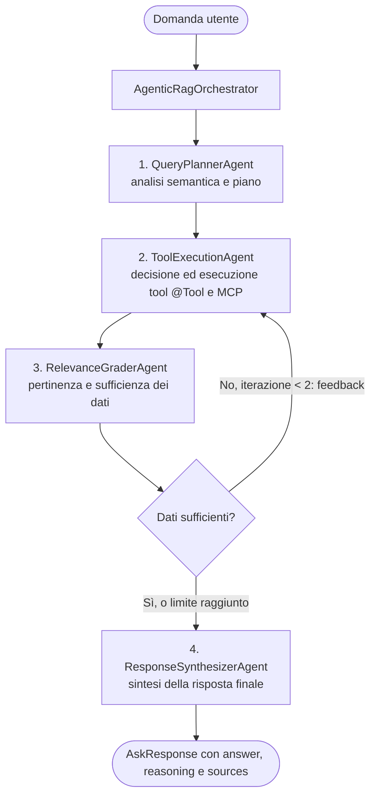

# Spring AI RAG Assistant POC con orchestrazione agentica
*(versione singolo agente presente sul branch **single-agent-rag**)*

POC in Java 21 / Spring Boot 4 / Spring AI 2 che realizza un assistente aziendale conversazionale basato su **RAG (Retrieval-Augmented Generation)** con **orchestrazione agentica multi-agente** e tool calling.

> **Questa versione del RAG usa un'orchestrazione agentica** : invece di una singola chiamata monolitica al modello, la richiesta attraversa una pipeline coordinata da un orchestratore (`AgenticRagOrchestrator`) in cui agenti specializzati si occupano di **pianificazione**, **esecuzione dei tool**, **valutazione critica** dei dati recuperati e **sintesi** della risposta, con un ciclo di retroazione correttiva quando i dati risultano insufficienti. Vedi [Orchestrazione agentica](#orchestrazione-agentica).

Il modulo RAG consente di interrogare la documentazione aziendale, recuperando i documenti pertinenti e restituendo i relativi riferimenti. Un layer di tool calling read-only permette inoltre di interrogare dati transazionali su PostgreSQL e di invocare servizi esposti da server *MCP (Model Context Protocol)* configurati nell'applicazione. Tutti gli strumenti sono utilizzati dall'agente esecutore, che decide in autonomia quali invocare.

L'assistente risponde in italiano, separa il ragionamento interno dalla risposta destinata all'utente e restituisce i riferimenti ai documenti effettivamente recuperati.

> **Avvertenza:** è un POC didattico. Non implementa autenticazione, autorizzazione multi-tenant, rate limiting, antivirus sui file caricati, cifratura dei dati aziendali né policy di retention. Non esporlo direttamente su Internet.

---

## Indice

- [Funzionalità](#funzionalità)
- [Architettura](#architettura)
- [Orchestrazione agentica](#orchestrazione-agentica)
- [Stack tecnologico](#stack-tecnologico)
- [Prerequisiti](#prerequisiti)
- [Installazione e avvio](#installazione-e-avvio)
- [Configurazione](#configurazione)
- [API REST](#api-rest)
- [Tools disponibili](#tools-disponibili)
- [Integrazione MCP client](#integrazione-mcp-client)
- [Pipeline RAG](#pipeline-rag)
- [Persistenza dei dati](#persistenza-dei-dati)
- [Test](#test)
- [Struttura del progetto](#struttura-del-progetto)
- [Decisioni progettuali e limiti noti](#decisioni-progettuali-e-limiti-noti)

---

## Funzionalità

- **API REST** per domande in linguaggio naturale.
- **RAG con orchestrazione agentica**: un orchestratore coordina quattro agenti specializzati (*planner*, *executor*, *grader*, *synthesizer*), ciascuno con un prompt e una responsabilità isolata.
- **Ciclo di retroazione correttiva**: il `RelevanceGraderAgent` valuta pertinenza e sufficienza dei dati recuperati; se sono insufficienti, l'esecuzione viene ripetuta (massimo 2 iterazioni) passando all'executor il feedback sulle informazioni mancanti.
- **Retrieval su decisione del modello**: l'agente esecutore decide autonomamente quando interrogare l'indice documentale, invocando il tool `searchDocuments`; la ricerca semantica avviene solo se necessaria.
- **Ingestion documentale** via multipart con Apache Tika: estrazione del testo, chunking con overlap e metadati `source`, `chunk`, `documentType`, `contentType`.
- **Indicizzazione unificata**: PDF e TXT (e gli altri formati supportati da Tika) finiscono nello stesso VectorStore `pgvector`; la ricerca è globale e non applica filtri sul formato del documento.
- **Tool calling read-only** verso PostgreSQL: ricerca ordini per stato, dettaglio ordine per ID, somma importi per stato, data e ora corrente.
- **Risposta strutturata** con separazione netta tra `thinking` (processo logico interno) e `answer` (risposta completa per l'utente), con tabelle Markdown preservate.
- **Riferimenti alle fonti**: ogni risposta include i documenti da cui provengono i chunk recuperati (`sources`).
- **Cronologia conversazionale** esposta via API, con tracciamento per singola conversazione degli scambi, del modello utilizzato e delle fonti citate.
- **Dataset dimostrativo** con 6 ordini fittizi in 4 stati e vincoli di integrità applicati lato database.
- **Integrazione MCP client**: connessione a server MCP esterni per l'estensione dei tools disponibili al modello, con supporto sync e registration automatica degli strumenti.

---

## Architettura

### Componenti

| Componente | Responsabilità |
|---|---|
| `api` | Controller REST e contratti JSON di richiesta/risposta (`AskRequest`, `AskResponse`). |
| `agent` | Orchestrazione agentica: `AgenticRagOrchestrator` e agenti `QueryPlannerAgent`, `ToolExecutionAgent`, `RelevanceGraderAgent`, `ResponseSynthesizerAgent`, con i relativi record di stato (`QueryPlan`, `ToolExecutionResult`, `EvaluationResult`). |
| `config` | Costruzione dei `ChatClient` (con tool per l'executor, senza tool per gli altri agenti) e registrazione del `MessageTrackerAdvisor`. |
| `constants` | Chiavi condivise nel contesto degli advisor e dei tools (`Constants`). |
| `model` | Record di dominio: risposta strutturata del modello, riferimenti alle fonti, contesto dei documenti recuperati, metadati di cronologia. |
| `order` | Accesso JDBC read-only alla tabella `orders` (`OrderRepository`) e proiezione `OrderSummary`. |
| `service` | Punto di ingresso verso l'orchestratore (`AssistantService`), ingestion (`DocumentIngestionService`), cronologia (`ChatHistoryService`), sanitizzazione dell'output (`ReasoningSanitizer`). |
| `tools` | Tool esposti al modello, tutti read-only: `OrderTools`, `DocumentTools`, `OtherTools`. |
| `utils` | `DocumentManager`: rilevamento MIME/formato via Tika, parsing della risposta strutturata via `BeanOutputConverter`. |
| `mcp` | Client MCP per l'integrazione con server esterni, registrazione automatica dei tools e tracking delle callback.

### Flusso di una richiesta `/api/ask`

1. `AssistantController` valida la domanda e recupera (o crea) il `conversationId` dalla `HttpSession`.
2. `AssistantService` delega all'`AgenticRagOrchestrator`, che registra il messaggio utente tramite `MessageTrackerAdvisor` (numero progressivo del messaggio) e crea un `RetrievedDocumentsContext` per la richiesta.
3. **Pianificazione**: il `QueryPlannerAgent` analizza la domanda e produce un `QueryPlan` (intento, dati necessari, fonti suggerite, indicazioni operative).
4. **Esecuzione**: il `ToolExecutionAgent` riceve domanda e piano e decide in autonomia quali tool invocare (documenti, ordini, data/ora, tool MCP). Ogni invocazione di `DocumentTools.searchDocuments` esegue una `similaritySearch` sul VectorStore e accumula i chunk in `RetrievedDocumentsContext` tramite `ToolContext`.
5. **Valutazione**: il `RelevanceGraderAgent` giudica pertinenza e sufficienza dei dati raccolti. Se insufficienti e non è stato raggiunto il limite di 2 iterazioni, l'orchestratore ripete i passi 4-5 passando all'executor il feedback del grader.
6. **Sintesi**: il `ResponseSynthesizerAgent` redige la risposta finale in italiano, con tabelle Markdown per i record di database e senza riferimenti ai dettagli implementativi. `ReasoningSanitizer` estrae i blocchi `<think>` / `<thought>`, ricolloca eventuali tabelle Markdown nel campo `answer` e normalizza l'output.
7. L'orchestratore registra la risposta nella cronologia (`MessageTrackerAdvisor`) e la risposta HTTP contiene `answer`, `reasoning`, `sources`, `model` e `conversationId`.
8. Gli eventuali tool provenienti dai server MCP sono registrati automaticamente sul `ChatClient` dell'executor e sono disponibili per l'invocazione dal modello.

### Scelte architetturali

- **Orchestrazione multi-agente**: la logica di una singola chiamata monolitica è scomposta in agenti con responsabilità isolate (pianificare, eseguire, valutare, sintetizzare), coordinati da una macchina a stati nell'orchestratore. Ogni fase è testabile e osservabile separatamente.
- **Agenti con e senza tool**: solo l'agente esecutore dispone dei tool (locali e MCP); planner, grader e synthesizer usano un `ChatClient` privo di tool, così che la pianificazione, la critica e la sintesi non possano innescare effetti collaterali.
- **Separazione reasoning/answer**: il synthesizer abilita il *thinking* del modello e il campo `reasoning` viene mantenuto distinto da `answer`; la sanitizzazione applicata a valle garantisce che eventuali riflessioni interne o tag `<think>` non trapelino nella risposta finale.
- **Retrieval su invocazione**: il contesto documentale non viene sempre precaricato nel prompt, ma iniettato solo quando l'agente esecutore lo richiede, riducendo consumo di token e rumore semantico.
- **Advisor come punto unico di osservabilità**: il tracciamento dei messaggi è centralizzato in un advisor Spring AI, indipendente dal servizio che orchestra la chat.
- **Contesto in-process**: `RetrievedDocumentsContext` e la cronologia vivono in memoria e sono quindi limitati a una singola istanza dell'applicazione.
- **Integrazione MCP**: i server MCP esterni vengono scoperti automaticamente e i loro tools registrati sul ChatClient, estendendo le capacità dell'assistente senza modifiche al codice Java.

---

## Orchestrazione agentica

Questa versione del RAG è organizzata come workflow multi-agente. Ogni agente è un componente Spring (`@Component`) con un proprio prompt di sistema e un contratto di input/output esplicito; l'`AgenticRagOrchestrator` li coordina.



### Agenti

| Agente | Responsabilità | Input → Output | Tool |
|---|---|---|---|
| `QueryPlannerAgent` | Scompone la domanda, identifica i dati necessari e le fonti più adatte (database ordini, documenti, data/ora). Non risponde alla domanda. | domanda → `QueryPlan` (`intent`, `informationNeeds`, `suggestedSources`, `executionGuidance`) | No |
| `ToolExecutionAgent` | Decide in autonomia, tramite function calling, quali tool invocare e con quali parametri (`searchDocuments`, tool ordini, tool data/ora locali e MCP). In caso di retry riceve il feedback del grader e si concentra sulle lacune indicate. | domanda + piano + feedback opzionale → `ToolExecutionResult` (`summary`: riepilogo dell'LLM; `rawOutput`: output reale dei tool) | Sì (locali + MCP) |
| `RelevanceGraderAgent` | Valuta in modo critico se i dati recuperati sono pertinenti e sufficienti a rispondere senza ipotizzare nulla; se mancano elementi, indica cosa cercare. Basa il giudizio sull'**output grezzo dei tool** e segnala eventuali discrepanze del riepilogo dell'executor (record omessi, troncati o alterati). | domanda + piano + risultato dei tool → `EvaluationResult` (`isRelevant`, `isSufficient`, `confidenceScore` HIGH/MEDIUM/LOW, `feedback`) | No |
| `ResponseSynthesizerAgent` | Redige la risposta finale in italiano usando solo i dati recuperati (l'**output grezzo dei tool** è la fonte di verità, il riepilogo dell'executor è solo contesto): tabelle Markdown per i record di database, distinzione tra dati transazionali e documenti, nessuna allucinazione né riferimenti a nomi di tool. Abilita il *thinking* del modello per popolare `reasoning`. | domanda + risultato dei tool + valutazione → `AskResponse` | No |
| `AgenticRagOrchestrator` | Coordina il workflow, gestisce il ciclo di retry (massimo 2 iterazioni), registra messaggio utente e risposta nella cronologia e restituisce l'`AskResponse`. | domanda + `conversationId` → `AskResponse` | — |

### Ciclo di retroazione correttiva

1. L'orchestratore esegue `ToolExecutionAgent` e poi `RelevanceGraderAgent`.
2. Se `isSufficient` è `true`, il ciclo termina e si passa alla sintesi.
3. Altrimenti il `feedback` del grader viene passato all'executor nell'iterazione successiva, che esegue le ricerche o i tool necessari per colmare le lacune.
4. Alla seconda iterazione il ciclo termina comunque: se i dati risultano ancora parziali, il synthesizer riceve lo stato `Parziale` con il relativo feedback e dichiara esplicitamente i limiti della risposta.

Il `RetrievedDocumentsContext` è condiviso tra le iterazioni: i chunk recuperati in tutti i tentativi confluiscono nel campo `sources` della risposta.

### Output grezzo dei tool

L'executor è un LLM che, dopo aver invocato i tool, produce un riepilogo testuale; quel riepilogo può troncare tabelle o parafrasare male le procedure. Per questo grader e synthesizer non si basano solo su di esso:

1. A ogni esecuzione l'executor crea un `ToolOutputTrace` e lo passa ai tool nel `ToolContext`.
2. `LoggingToolCallback` registra nella traccia nome, input e **output reale** di ogni tool invocato (record del database, chunk documentali, risposte MCP).
3. La traccia, resa in forma testuale, finisce in `ToolExecutionResult.rawOutput`; grader e synthesizer la ricevono come fonte di verità accanto al riepilogo (`summary`).

Per non saturare il contesto dei modelli locali la resa della traccia ha un budget di 16.000 caratteri ripartito tra le invocazioni; un output troncato è segnalato nel testo con il marker `OUTPUT TROCATO`, così grader e synthesizer sanno che i dati possono essere incompleti. In caso di retry la traccia riguarda solo l'ultima iterazione.

### Robustezza

- **Fallback del planner**: se l'output strutturato non è ottenibile, viene usato un piano generico (fonti `DATABASE` e `RAG_DOCUMENTS`).
- **Fallback del grader**: se la valutazione strutturata fallisce, i dati sono considerati sufficienti solo se l'esecuzione ha prodotto un riepilogo non vuoto (confidenza `MEDIUM`), altrimenti insufficienti (confidenza `LOW`).
- **Log strutturati per fase**: ogni agente scrive log con prefisso dedicato (`[ORCHESTRATOR]`, `[PLANNER-AGENT]`, `[TOOL-AGENT]`, `[GRADER-AGENT]`, `[SYNTHESIZER-AGENT]`) e il numero di messaggio, per ricostruire l'intero flusso di una richiesta.

> **Costo dell'orchestrazione:** ogni richiesta comporta più chiamate al modello (planner, executor e grader per ciascuna iterazione, synthesizer), da 4 a 6 oltre alle eventuali chiamate di tool calling dell'executor. Latenza e consumo di risorse sono quindi superiori rispetto a una singola chiamata, soprattutto con modelli locali su hardware limitato.

---

## Stack tecnologico

| Componente | Versione |
|---|---|
| Java | 21 |
| Spring Boot | 4.1.1 |
| Spring AI | 2.0.1 (`spring-ai-bom`) |
| Spring AI Starter | `spring-ai-starter-model-ollama`, `spring-ai-starter-vector-store-pgvector`, `spring-ai-starter-mcp-client` |
| Modello LLM ed embedding | Ollama (locale) |
| Database | PostgreSQL 17 + estensione `pgvector` |
| Estrazione testo | Apache Tika 4.1.0 (`tika-core`, `tika-parsers-standard-package`) |
| Accesso dati | `spring-boot-starter-jdbc` (`JdbcTemplate`, query parametrizzate) |
| Utility | Lombok (scope `provided`) |
| Build | Maven 3.9+ |

---

## Prerequisiti

1. **JDK 21**.
2. **Maven 3.9+**.
3. **Docker Engine / Docker Compose** per il database con pgvector.
4. **[Ollama](https://ollama.com/)** installato e in esecuzione sull'host.

### Modelli Ollama

```bash
ollama pull LiquidAI/lfm2.5-2.6b:latest
ollama pull nomic-embed-text
```

Il modello chat **deve supportare il tool calling**: senza questa feature il modello non può invocare i tools e l'assistente degrada a una risposta priva di dati verificati. Modelli alternativi testati: `llama3.2:latest` e `qwen3:4b`.

Per l'embedding è utilizzato `nomic-embed-text` (768 dimensioni). Se si cambia modello, verificare la dimensionalità e allineare `spring.ai.vectorstore.pgvector.dimensions`.

> Le prestazioni dipendono dal modello e dall'hardware locale. Se `LiquidAI/lfm2.5-2.6b:latest` non è disponibile nella propria installazione Ollama, impostare `OLLAMA_CHAT_MODEL` con un modello installato che supporti il tool calling.

---

## Installazione e avvio

### 1. Avvio del database

```bash
docker compose up -d
```

Il compose avvia `pgvector/pgvector:pg17` con database `enterprise_ai`, utente `enterprise` e password `enterprise`, esposti su `localhost:5432` e dotati di health check. Su Windows sono disponibili gli script `start.bat` (avvio) e `stop.bat` (arresto).

### 2. Verifica di Ollama

```bash
ollama list
```

### 3. Avvio dell'applicazione

```bash
mvn spring-boot:run
```

L'applicazione è disponibile su `http://localhost:8080`. Al primo avvio:

- `schema.sql` abilita l'estensione `vector` e crea la tabella `orders` (con vincolo `CHECK` sugli stati ammessi);
- `data.sql` carica i 6 ordini dimostrativi;
- Spring AI inizializza lo schema del VectorStore (tabella `vector_store`, indice HNSW su similarità coseno).

Entrambi gli script SQL sono idempotenti (`CREATE TABLE IF NOT EXISTS`, `ON CONFLICT DO NOTHING`).

---

## Configurazione

Le proprietà sono definite in `src/main/resources/application.yml` e sovrascrivibili tramite variabili d'ambiente.

| Variabile | Proprietà | Default | Descrizione |
|---|---|---|---|
| `SERVER_PORT` | `server.port` | `8080` | Porta di ascolto HTTP |
| `DB_URL` | `spring.datasource.url` | `jdbc:postgresql://localhost:5432/enterprise_ai` | JDBC URL del database |
| `DB_USERNAME` | `spring.datasource.username` | `enterprise` | Utente PostgreSQL |
| `DB_PASSWORD` | `spring.datasource.password` | `enterprise` | Password PostgreSQL |
| `OLLAMA_BASE_URL` | `spring.ai.ollama.base-url` | `http://localhost:11434` | Endpoint del runtime Ollama |
| `OLLAMA_CHAT_MODEL` | `spring.ai.ollama.chat.options.model` | `LiquidAI/lfm2.5-2.6b:latest` | Modello conversazionale (richiede tool calling) |
| `OLLAMA_EMBEDDING_MODEL` | `spring.ai.ollama.embedding.model` | `nomic-embed-text` | Modello di embedding |
| `APP_RAG_TOP_K` | `app.rag.top-k` | `6` | Chunk recuperati per ogni invocazione del tool documentale |

Parametri non sovrascrivibili da variabili d'ambiente ma regolabili nel file di configurazione:

| Proprietà | Valore | Descrizione |
|---|---|---|
| `spring.ai.ollama.chat.options.temperature` | `0.1` | Temperatura di campionamento, bassa per favorire il determinismo |
| `spring.ai.vectorstore.pgvector.dimensions` | `768` | Dimensionalità dei vettori (deve coincidere con il modello di embedding) |
| `spring.ai.vectorstore.pgvector.index-type` | `HNSW` | Tipo di indice vettoriale |
| `spring.ai.vectorstore.pgvector.distance-type` | `COSINE_DISTANCE` | Metrica di distanza |
| `spring.ai.vectorstore.pgvector.table-name` | `vector_store` | Tabella dell'indice documentale |
| `spring.servlet.multipart.max-file-size` | `20MB` | Dimensione massima per singolo file caricato |
| `spring.servlet.multipart.max-request-size` | `20MB` | Dimensione massima della richiesta multipart |

> **Attenzione alle dimensioni degli embedding:** se si cambia modello di embedding, aggiornare `spring.ai.vectorstore.pgvector.dimensions`. Se il volume PostgreSQL contiene già una tabella vettoriale creata con dimensioni diverse, la ricreazione del volume è necessaria e comporta la perdita dei dati di test.

### Configurazione MCP client

Le impostazioni MCP sono disponibili nella sezione `spring.ai.mcp.client` di `application.yml`:

| Variabile | Proprietà | Default | Descrizione |
|---|---|---|---|
| `mcp.client.enabled` | `spring.ai.mcp.client.enabled` | `true` | Attiva/disattiva l'integrazione MCP client |
| `mcp.client.name` | `spring.ai.mcp.client.name` | `ai-agent-qa-demo` | Nome dell'MCP client |
| `mcp.client.version` | `spring.ai.mcp.client.version` | `1.0.0` | Versione dell'MCP client |
| `mcp.client.type` | `spring.ai.mcp.client.type` | `SYNC` | Tipo di connessione (SYNC o ASYNC) |
| `mcp.client.request-timeout` | `spring.ai.mcp.client.request-timeout` | `20s` | Timeout delle richieste verso i server MCP |

Server MCP configurati:

| Server | URL | Endpoint |
|---|---|---|
| date-time-tools | `https://date-time-tools.iabhishek.workers.dev` | `/mcp` |

Ogni server MCP registra automaticamente i propri tools disponibili, che diventano immediatamente invocabili dal modello tramite il tool calling. La registrazione avviene all'avvio dell'applicazione e gli strumenti sono visibili nei log (`[MCP Connection: ...] [MCP Server: ...] [Tool: ...]`).

---

## API REST

Tutte le API sono esposte sotto il prefisso `/api`.

### 1. `POST /api/ask` — interrogazione dell'assistente

**Request body**

```json
{ "question": "Qual è la procedura per gestire gli ordini in ritardo?" }
```

**Risposta 200**

```json
{
  "answer": "Gli ordini in ritardo vengono verificati dal reparto Operations...",
  "reasoning": "Ho consultato la procedura aziendale e verificato gli ordini in stato IN_PROGRESS...",
  "sources": [
    {
      "id": "6c0e2a1b-8f3d-4a2e-9c7b-1d5f4e3a2b10",
      "source": "procedura-gestione-ordini.txt",
      "chunk": 1
    }
  ],
  "model": "LiquidAI/lfm2.5-2.6b:latest",
  "conversationId": "0d9a0e5a-3f0c-4f5e-9b21-6a0f2c1d4e77"
}
```

| Campo | Tipo | Descrizione |
|---|---|---|
| `answer` | `string` | Risposta completa per l'utente, con tabelle Markdown quando i dati provengono dal database |
| `reasoning` | `string` | Processo logico interno prodotto dal `ResponseSynthesizerAgent`, separato dalla risposta |
| `sources` | `array` | Riferimenti univoci (`id`, `source`, `chunk`) ai chunk recuperati dal VectorStore in tutte le iterazioni dell'orchestrazione |
| `model` | `string` | Modello effettivamente utilizzato per generare la risposta |
| `conversationId` | `string` | Identificativo della conversazione, associato alla sessione HTTP |

**Errori**

| Codice | Causa |
|---|---|
| `400 Bad Request` | Campo `question` assente o vuoto |
| `500 Internal Server Error` | Errore di ingestion o indisponibilità di Ollama/PostgreSQL |

`sources` rappresenta i documenti da cui provengono i chunk recuperati per la domanda: non è una certificazione automatica che il modello abbia citato correttamente ogni fonte.

**Esempi**

```bash
# Domanda documentale (procedura aziendale)
curl -X POST http://localhost:8080/api/ask \
  -H "Content-Type: application/json" \
  -d '{"question":"Qual è la procedura per gestire gli ordini in ritardo?"}'

curl -X POST http://localhost:8080/api/ask \
  -H "Content-Type: application/json" \
  -d '{"question":"Ho una fattura da pagare in cui un ordine non corrisponde a quanto richiesto, cosa devo fare?"}'

# Domanda transazionale (tool sul database)
curl -X POST http://localhost:8080/api/ask \
  -H "Content-Type: application/json" \
  -d '{"question":"Mostrami gli ordini in lavorazione e il loro importo"}'

# Domanda combinata RAG + database
curl -X POST http://localhost:8080/api/ask \
  -H "Content-Type: application/json" \
  -d '{"question":"Quali ordini sono in lavorazione e cosa prevede la procedura per quelli in ritardo?"}'
```

### 2. `POST /api/new` — nuova conversazione

Rimuove il contesto precedente associando un nuovo `conversationId` alla sessione.

```bash
curl -X POST http://localhost:8080/api/new
```

```json
{ "status": "ok" }
```

### 3. `POST /api/documents` — ingestion documentale

Endpoints `multipart/form-data`, campo obbligatorio `file`, dimensione massima 20 MB.

```bash
curl -X POST http://localhost:8080/api/documents \
  -F "file=@documents/procedura-gestione-ordini.txt;type=text/plain"

curl -X POST http://localhost:8080/api/documents \
  -F "file=@documents/procedura-gestione-fatture.pdf;type=application/pdf"

curl -X POST http://localhost:8080/api/documents \
  -F "file=@/percorso/documento.pdf;type=application/pdf"
```

**Risposta 200**

```json
{
  "filename": "procedura-gestione-ordini.txt",
  "chunksIndexed": 1,
  "status": "indexed"
}
```

| Codice | Causa |
|---|---|
| `400 Bad Request` | File vuoto |
| `500 Internal Server Error` | Documento privo di testo estraibile (es. PDF scansionato) o errore durante l'indicizzazione |

L'endpoint **aggiunge** i chunk all'indice e non rimuove le versioni precedenti dello stesso documento.

### 4. `GET /api/history` — cronologia della conversazione

Restituisce i messaggi registrati per la conversazione associata alla sessione corrente. Se la sessione non ha ancora una conversazione, l'array è vuoto.

```bash
curl -c cookies.txt -b cookies.txt http://localhost:8080/api/history
```

```json
[
  {
    "name": "USER",
    "text": "Qual è la procedura per gestire gli ordini in ritardo?",
    "metadata": {
      "timestamp": "2026-10-22T08:31:12Z"
    }
  },
  {
    "name": "ASSISTANT",
    "answer": "Gli ordini in ritardo vengono verificati dal reparto Operations...",
    "thinking": "Ho recuperato la procedura aziendale...",
    "metadata": {
      "sources": [
        { "id": "6c0e2a1b-...", "source": "procedura-gestione-ordini.txt", "chunk": 1 }
      ],
      "model": "LiquidAI/lfm2.5-2.6b:latest",
      "timestamp": "2026-10-22T08:31:15Z"
    }
  }
]
```

| Campo | Tipo | Descrizione |
|---|---|---|
| `name` | `string` | Ruolo del messaggio (`USER` / `ASSISTANT`) |
| `text` | `string` | Contenuto grezzo del messaggio (presente per i messaggi utente) |
| `answer` | `string` | Risposta strutturata (presente per i messaggi dell'assistente) |
| `thinking` | `string` | Processo logico interno e pianificazione, separato dalla risposta |
| `metadata` | `object` | Timestamp, modello e fonti citate |

### 5. Verifica diretta dei dati su PostgreSQL

```bash
docker compose exec postgres psql -U enterprise -d enterprise_ai \
  -c "SELECT id, customer_name, status, amount FROM orders ORDER BY id;"
```

---

## Tools disponibili

I tools sono metodi Java annotati con `@Tool`, registrati sul `ChatClient` del `ToolExecutionAgent` (l'unico agente che ne dispone) e invocabili dal modello. Sono tutti **read-only** e utilizzano query SQL parametrizzate. I tools provenienti dai server MCP sono registrati automaticamente all'avvio.

| Tool | Componente | Parametri | Comportamento |
|---|---|---|---|
| `searchDocuments` | `DocumentTools` | `query` | Ricerca semantica sul VectorStore con `top-k` chunk; i chunk recuperati vengono accumulati nel contesto e riportati in `sources` |
| `findOrdersByStatus` | `OrderTools` | `status` | Ricerca ordini per stato. Se lo stato è omesso per default viene impostato a `IN_PROGRESS`; massimo 100 righe ordinate per data di consegna prevista |
| `findOrderById` | `OrderTools` | `orderId` | Dettaglio di un ordine tramite identificativo numerico positivo |
| `sumOrderAmountsByStatus` | `OrderTools` | `status` | Somma degli importi degli ordini in uno stato (`COALESCE(SUM(amount), 0)`) |
| `getCurrentDateTime` | `OtherTools` | — | Data e ora correnti |
| *tool MCP* | *server MCP* | *vari* | *Tool esterni registrati automaticamente, visibili nei log di avvio* |

Se un tool viene invocato con uno stato non riconosciuto non produce errore: la ricerca restituisce un elenco vuoto e la somma `0`, evitando di tradurre un valore arbitrario in una query non parametrizzata.

---

## Pipeline RAG

### Ingestion

1. Rilevamento del formato tramite Tika (con il nome file come hint): il risultato è normalizzato in maiuscolo (`PDF`, `TXT`, `DOCX`, …); un tipo non riconoscibile viene marcato come `UNKNOWN`.
2. Estrazione del testo: Tika con i parser standard.
3. Verifica che il testo non sia vuoto: un documento senza testo estraibile viene rifiutato.
4. Chunking a **caratteri**, con dimensione `1200` e overlap `180`, privilegiando come punto di taglio i confini naturali (paragrafo, riga, spazio) quando disponibili oltre metà chunk.
5. Indicizzazione: ogni chunk diventa un `Document` con metadati:

| Metadato | Contenuto |
|---|---|
| `source` | Nome file originale |
| `chunk` | Indice del chunk (1-based) |
| `documentType` | Formato rilevato, in minuscolo |
| `contentType` | MIME type rilevato da Tika |

6. `vectorStore.add(...)`: tutti i formati confluiscono nella stessa tabella `vector_store`.

### Retrieval

La ricerca viene eseguita **solo** quando il `ToolExecutionAgent` invoca `searchDocuments`, in base al piano ricevuto dal planner e all'eventuale feedback del grader (in caso di retry la ricerca può essere ripetuta con una query diversa):

- `VectorStore.similaritySearch` con `top-k` configurabile (`app.rag.top-k`, default `6`);
- indice **HNSW** con metrica **COSINE_DISTANCE** su vettori a **768 dimensioni**;
- la ricerca è **globale**: non distingue per formato né per documento, e può quindi restituire chunk provenienti da file diversi.

### Valutazione

I dati recuperati non vengono usati direttamente per la risposta: il `RelevanceGraderAgent` ne valuta pertinenza e sufficienza e, se necessario, innesca un nuovo ciclo di recupero (vedi [Orchestrazione agentica](#orchestrazione-agentica)).

### Generazione

La risposta finale è prodotta dal `ResponseSynthesizerAgent`, il cui prompt di sistema impone: risposta in italiano, uso dei soli dati recuperati, divieto di inventare informazioni, distinzione tra dati di database e contenuti documentali, output dei record in tabelle Markdown e assenza di riferimenti a nomi di tools o dettagli implementativi.

La risposta viene poi normalizzata da `ReasoningSanitizer`, che:

- estrae i blocchi `<think>` / `<thought>` (anche non chiusi) verso il campo `reasoning`;
- preserva integralmente tabelle Markdown e a capo nel campo `answer`;
- recupera nel `answer` eventuali tabelle erroneamente prodotte nel `reasoning`;
- applica il fallback `Il modello non ha restituito una risposta.` quando la risposta è assente.

---

## Integrazione MCP client

L'applicazione supporta l'integrazione con server esterni conformi al Model Context Protocol (MCP), consentendo l'estensione dinamica dei tools disponibili al modello linguistico.

### Funzionalità

- **Registrazione automatica**: all'avvio, il client MCP sincrono (`SYNC`) connette ai server specificati in `application.yml` e i tools disponibili.
- **Tool calling esteso**: i tools dei server MCP diventano immediatamente invocabili dal modello, con gli stessi vincoli `read-only` degli strumenti locali.
- **Logging centralizzato**: ogni invocazione e registrazione MCP è visibile nei log applicativi con il prefisso `[MCP Connection: ...] [MCP Server: ...] [Tool: ...]`.
- **Supporto sync/async**: configurabile tramite `spring.ai.mcp.client.type` (default `SYNC`).

### Configurazione

L'integrazione MCP è configurata nella sezione `spring.ai.mcp.client` di `application.yml`. L'esempio corrente configura un client sync che si connette a `date-time-tools.iabhishek.workers.dev` sull'endpoint `/mcp`.

Per aggiungere nuovi server MCP, aggiungere un blocco `streamable-http` nella sezione `mcp.client.connections`, specificando:
- `url`: l'endpoint del server MCP remoto
- `endpoint`: il percorso dell'endpoint MCP (default `/mcp`)

### Esempio di configurazione MCP aggiuntiva

```yaml
spring:
  ai:
    mcp:
      client:
        enabled: true
        name: ai-agent-qa-demo
        version: 1.0.0
        type: SYNC
        request-timeout: 20s

        streamable-http:
          connections:
            date-time-tools:
              url: https://date-time-tools.iabhishek.workers.dev
              endpoint: /mcp
```

### Flussi di lavoro

1. All'avvio, `AiConfiguration` crea bean `McpSyncClient` per ogni server configurato.
2. Viene chiamata `client.listTools()` per introspectare gli strumenti disponibili.
3. I tools vengono registrati sul `ChatClient` insieme agli strumenti locali.
4. Il modello può invocare questi tools usando la sintassi standard del tool calling.
5. Le callback di logging sono registrate per tracciare l'uso dei tools MCP.

---

## Persistenza dei dati

### Tabella `orders` (schema.sql)

```sql
CREATE TABLE IF NOT EXISTS orders (
    id BIGINT PRIMARY KEY,
    customer_name VARCHAR(150) NOT NULL,
    status VARCHAR(30) NOT NULL,
    amount NUMERIC(12, 2) NOT NULL,
    order_date DATE NOT NULL,
    expected_delivery_date DATE NOT NULL,
    CONSTRAINT chk_orders_status CHECK (status IN ('NEW', 'IN_PROGRESS', 'SHIPPED', 'CANCELLED'))
);
```

Il vincolo `CHECK` replica a livello di database la whitelist applicata dai tool.

### Dataset dimostrativo (data.sql)

| ID | Cliente | Stato | Importo | Data ordine | Consegna prevista |
|---|---|---|---|---|---|
| 1001 | Alfa S.r.l. | `IN_PROGRESS` | 12.500,00 | 2026-09-10 | 2026-10-10 |
| 1002 | Beta S.p.A. | `NEW` | 4.300,50 | 2026-10-01 | 2026-10-20 |
| 1003 | Gamma S.r.l. | `SHIPPED` | 890,00 | 2026-09-15 | 2026-09-30 |
| 1004 | Delta S.p.A. | `IN_PROGRESS` | 28.750,00 | 2026-09-20 | 2026-10-08 |
| 1005 | Epsilon S.r.l. | `CANCELLED` | 1.650,00 | 2026-08-25 | 2026-09-15 |
| 1006 | Zeta S.p.A. | `IN_PROGRESS` | 7.200,00 | 2026-10-02 | 2026-10-25 |

Totale `IN_PROGRESS`: **48.450,00**.

### Tabella `vector_store`

Gestita automaticamente da Spring AI (schema `public`, tabella `vector_store`), con indice HNSW su embedding a 768 dimensioni. Gli schemi SQL dell'applicazione e quello del VectorStore coesistono sullo stesso database.

---

## Test

```bash
mvn test
```

La suite copre 35 test:

- **`DocumentIngestionServiceTest`** — comportamento dello splitting: chunk multipli con overlap, nessun chunk vuoto, rispetto della dimensione massima, documento breve in un unico chunk.
- **`ReasoningSanitizerTest`** — separazione reasoning/answer, estrazione dei tag `<think>` / `<thought>` (chiusi, non chiusi, case-insensitive, multipli), gestione di input nulli o vuoti, preservazione delle tabelle Markdown e recupero delle tabelle dal campo reasoning.
- **Test dell'orchestrazione agentica** (package `agent`):
  - `QueryPlannerAgentTest` — generazione del piano e fallback a un piano generico;
  - `ToolExecutionAgentTest` — invocazione del `ChatClient` con il `ToolContext` e gestione del feedback di retry;
  - `ToolExecutionResultTest` — normalizzazione dei campi e separazione tra `summary` e `rawOutput`;
  - `RelevanceGraderAgentTest` — restituzione della valutazione e fallback in caso di errore;
  - `ResponseSynthesizerAgentTest` — formattazione della risposta finale;
  - `AgenticRagOrchestratorTest` — flusso orchestrato con successo al primo tentativo e con retry per dati insufficienti;
  - `AgentModelSerializationTest` e `AgentBeansInstantiationTest` — serializzazione dei record di stato e istanziazione dei bean degli agenti.
- **`ToolOutputTraceTest`** — resa della traccia dei tool, troncamento con marker esplicito, ripartizione del budget tra le invocazioni.
- **`MessageTrackerAdvisorTest`** e **`LoggingToolCallbackTest`** — tracciamento dei messaggi, logging delle invocazioni dei tool e registrazione dell'output grezzo nella traccia.

---

## Struttura del progetto

```text
.
├── docker-compose.yml            # PostgreSQL 17 + pgvector
├── docs/                         # design document e piano dell'orchestrazione agentica
├── documents/                    # documenti di esempio (TXT, PDF)
├── start.bat / stop.bat          # shortcut Windows per Docker Compose
├── pom.xml
└── src/
    ├── main/java/it/davideangelone/assistant/
    │   ├── agent/                # orchestrazione agentica
    │   │   ├── orchestrator/     # AgenticRagOrchestrator (workflow e ciclo di retry)
    │   │   ├── planner/          # QueryPlannerAgent
    │   │   ├── executor/         # ToolExecutionAgent
    │   │   ├── grader/           # RelevanceGraderAgent
    │   │   ├── synthesizer/      # ResponseSynthesizerAgent
    │   │   └── model/            # QueryPlan, ToolExecutionResult, EvaluationResult
    │   ├── api/                  # controller REST e DTO (AskRequest, AskResponse)
    │   ├── config/               # AiConfiguration (ChatClient con tool, MCP client e tool callbacks),
    │   │                         # MessageTrackerAdvisor
    │   ├── constants/            # chiavi del contesto advisor/tool
    │   ├── model/                # record di dominio (fonti, cronologia, contesto documenti, ToolOutputTrace)
    │   ├── order/                # OrderRepository (JDBC) e OrderSummary
    │   ├── service/              # AssistantService, DocumentIngestionService,
    │   │                         # ChatHistoryService, ReasoningSanitizer
    │   ├── tools/                # OrderTools, DocumentTools, OtherTools, LoggingToolCallback
    │   └── utils/                # DocumentManager (Tika, parsing risposta)
    ├── main/resources/
    │   ├── application.yml       # configurazione Spring, AI, VectorStore, upload, MCP
    │   ├── schema.sql            # estensione vector + tabella orders
    │   └── data.sql              # ordini dimostrativi
    └── test/java/it/davideangelone/assistant/
        ├── agent/                # test di agenti, orchestratore e modelli di stato
        ├── config/               # MessageTrackerAdvisorTest
        ├── model/                # ToolOutputTraceTest
        ├── service/              # DocumentIngestionServiceTest, ReasoningSanitizerTest
        └── tools/                # LoggingToolCallbackTest
```

---

## Decisioni progettuali e limiti noti

### Decisioni

- **Il modello non accede mai direttamente al database**: interagisce esclusivamente con metodi Java che eseguono query SQL parametrizzate e read-only, con whitelist degli stati e limiti di cardinalità.
- **Orchestrazione agentica con responsabilità isolate**: pianificazione, esecuzione dei tool, valutazione e sintesi sono affidate ad agenti distinti coordinati da un orchestratore; solo l'agente esecutore dispone dei tool.
- **Valutazione critica con retry limitato**: un grader separato dal produttore dei dati verifica pertinenza e sufficienza e innesca al più un nuovo tentativo, per contenere latenza e costo; se i dati restano parziali la risposta lo dichiara.
- **Retrieval agentico**: il contesto documentale viene recuperato solo su richiesta esplicita dell'agente esecutore, evitando di contaminare ogni risposta con chunk non pertinenti.
- **Isolamento del ragionamento**: `reasoning` e `answer` sono campi distinti dello schema strutturato, con sanitizzazione difensiva a valle.
- **Osservabilità centralizzata**: un singolo advisor registra richieste, risposte, modello e fonti, alimentando sia i log applicativi (`[CHAT-REQUEST]`, `[CHAT-ANSWER]`, `[TOOL]`) sia l'endpoint di cronologia.
- **Integrazione MCP**: i server MCP esterni vengono scoperti automaticamente e i loro tools registrati sul ChatClient, estendendo le capacità dell'assistente senza modifiche al codice Java.
- **Chunking basato su caratteri**: scelta pragmatica per il POC; per documenti complessi è opportuno adottare splitter token-based o strutturali (per esempio `MarkdownSectionSplitter`).
- **Formati delegati a Tika**: il supporto effettivo dipende dai parser inclusi in `tika-parsers-standard-package`; i PDF scansionati, privi di livello testuale, non sono indicizzabili senza OCR.

### Limiti noti

- **Nessuna autenticazione né autorizzazione**: chiunque può interrogare l'assistente e caricare documenti.
- **Nessun antivirus o controllo dei contenuti** dei file caricati.
- **Nessuna deduplicazione né reindicizzazione**: ricaricando lo stesso documento i chunk precedenti restano nell'indice.
- **Nessun OCR**: i PDF scansionati falliscono l'indicizzazione; è necessaria una pipeline OCR (ad esempio Tesseract) a monte.
- **Nessuna persistenza della cronologia**: conversazioni e log vivono in memoria, sono volatili al riavvio e non sono condivise tra più istanze dell'applicazione.
- **Nessun rate limiting né gestione della concorrenza per utente**.
- **Il modello decide quali fonti citare**: `sources` elenca i chunk recuperati, non garantisce che la risposta li referenzi correttamente.
- **Nessuna valutazione automatica della qualità del RAG** (nessun dataset di benchmark né metriche di faithfulness): il grader è un controllo a runtime basato sullo stesso LLM, non una metrica oggettiva.
- **Latenza e costo dell'orchestrazione**: da 4 a 6 chiamate al modello per richiesta; con modelli piccoli o locali la qualità del planning e del grading può essere variabile e i fallback (piano generico, valutazione basata sulla presenza di dati) sono euristiche semplici.
- **Retry limitato a 2 iterazioni**: se i dati restano insufficienti dopo il secondo tentativo, la sintesi procede con dati parziali.
- **Esecuzione sequenziale**: gli agenti sono eseguiti in modo sincrono e in serie, senza parallelismo né streaming della risposta.
- **Osservabilità basilare**: solo log applicativi; mancano tracing distribuito, metriche e correlazione per richiesta.
- **Codice didattico, non production-ready**: prima di un uso reale è necessario introdurre il layer di sicurezza, la persistenza dello stato conversazionale e il dimensionamento dell'infrastruttura (pool di connessioni, memoria, concorrenza dei tools).
- **Dipendenza dalla disponibilità dei server MCP**: se i server MCP esterni sono offline, i tools registrati da tali server non sono disponibili, anche se l'applicazione continua a funzionare con gli strumenti locali.