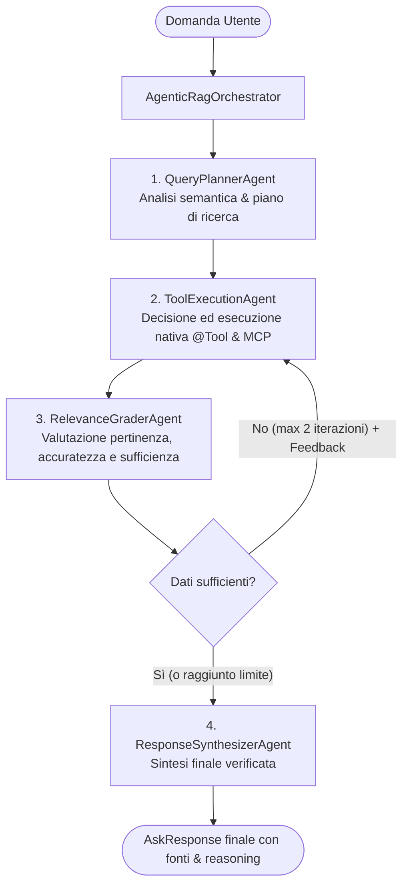

# Design Document: Orchestrated Agentic RAG with Spring AI

## 1. Overview and Goals
Trasformare il sistema Spring AI Enterprise Assistant da una singola chiamata monolitica a un'architettura **RAG Agentico Orchestrato**.
Ogni fase del ragionamento e dell'esecuzione è affidata ad un agente specializzato con responsabilità chiare e isolate:
1. **Analisi e Pianificazione dell'Intento** (`QueryPlannerAgent`): Analizza semantica, fabbisogno informativo e fonti necessarie.
2. **Esecuzione e Decisione Tool** (`ToolExecutionAgent`): Decide ed invoca autonomamente tramite annotazione nativa `@Tool` e protocollo MCP le risorse (database ordini, vector store pgvector, tool orari/esterni).
3. **Valutazione e Critica** (`RelevanceGraderAgent`): Valuta pertinenza, accuratezza e sufficienza dei dati recuperati, innescando un ciclo di retroazione correttiva se mancano informazioni.
4. **Sintesi Risposta** (`ResponseSynthesizerAgent`): Redige la risposta finale verificata, tabelle markdown e citazioni delle fonti.
5. **Orchestratore** (`AgenticRagOrchestrator`): Coordina il workflow, gestisce lo stato di sessione e il ciclo di retry (massimo 2 tentativi).

---

## 2. Architecture & Multi-Agent Flow



---

## 3. Detailed Component Specifications

### 3.1. Package Structure
Tutti i componenti agentici saranno collocati nel package `it.davideangelone.assistant.agent`:
- `it.davideangelone.assistant.agent.model.*`: Record per lo stato (`AgenticState`), piano (`QueryPlan`), valutazione (`EvaluationResult`).
- `it.davideangelone.assistant.agent.planner.QueryPlannerAgent`: Analisi query e generazione piano.
- `it.davideangelone.assistant.agent.executor.ToolExecutionAgent`: Selezione ed esecuzione tool nativi `@Tool` e MCP.
- `it.davideangelone.assistant.agent.grader.RelevanceGraderAgent`: Valutazione critica di pertinenza e completezza.
- `it.davideangelone.assistant.agent.synthesizer.ResponseSynthesizerAgent`: Sintesi della risposta finale aderente ai vincoli di output.
- `it.davideangelone.assistant.agent.orchestrator.AgenticRagOrchestrator`: Macchina a stati del flusso agentico.

---

### 3.2. Data Models

#### `QueryPlan`
```java
public record QueryPlan(
    String intent,
    List<String> informationNeeds,
    List<String> suggestedSources,
    String executionGuidance
) {}
```

#### `EvaluationResult`
```java
public record EvaluationResult(
    boolean isRelevant,
    boolean isSufficient,
    String confidenceScore, // HIGH, MEDIUM, LOW
    String feedback
) {}
```

#### `AgenticState`
Mantiene il contesto dell'elaborazione:
- `question`: domanda originale dell'utente
- `conversationId`: ID conversazione
- `plan`: piano generato dal `QueryPlannerAgent`
- `toolExecutionSummary`: testo / dati raccolti dall'esecuzione dei tool
- `retrievedContext`: istanza di `RetrievedDocumentsContext` per tenere traccia dei chunk di documenti vettoriali recuperati
- `evaluation`: esito della valutazione del `RelevanceGraderAgent`
- `iterationCount`: contatore di tentativi (fino a 2)
- `finalAnswer`: risposta finale prodotta dal `ResponseSynthesizerAgent`
- `reasoning`: sintesi del ragionamento dell'orchestratore e degli agenti

---

### 3.3. Agent Implementation Details

#### 1. `QueryPlannerAgent`
- **Dipendenze**: `ChatClient.Builder` (client senza tool).
- **Prompt**:
  "Sei un esperto analista di informazioni aziendali. Il tuo compito è analizzare la domanda dell'utente, scomporla negli elementi essenziali, identificare con precisione di quali dati si ha bisogno (ordini nel database, documenti procedurali aziendali, data/ora o strumenti esterni) e fornire indicazioni per il recupero."
- **Output**: Mappato structured output / BeanOutputConverter su `QueryPlan`.

#### 2. `ToolExecutionAgent`
- **Dipendenze**: `ChatClient` configurato con i tool nativi `@Tool` (`OrderTools`, `DocumentTools`, `OtherTools`) e MCP client callbacks (già preparati da `AiConfiguration`).
- **Prompt**:
  Istruzioni per l'LLM di consultare il piano di ricerca e i tool disponibili, decidendo in piena autonomia tramite function calling quale tool invocare con i parametri opportuni, oppure se rispondere direttamente se i dati sono già noti.
  Riceve in `toolContext` il riferimento a `RetrievedDocumentsContext` in modo che `DocumentTools.searchDocuments` continui a collezionare i documenti estratti da pgvector.
  Se è un retry dopo una valutazione insufficiente, riceve il feedback del grader.

#### 3. `RelevanceGraderAgent`
- **Dipendenze**: `ChatClient.Builder` (client senza tool).
- **Prompt**:
  "Sei un revisore critico di qualità e pertinenza dei dati recuperati. Confronta la domanda iniziale dell'utente e il piano informativo con i risultati ottenuti dall'agente esecutore. Valuta:
   1. I dati sono pertinenti alla domanda?
   2. I dati sono completi e sufficienti a rispondere con precisione senza allucinare?
   3. Se manca qualcosa, specifica esattamente cosa manca nel campo feedback."
- **Output**: Mappato structured output su `EvaluationResult`.

#### 4. `ResponseSynthesizerAgent`
- **Dipendenze**: `ChatClient.Builder` (client senza tool).
- **Prompt**:
  Riprende i vincoli di business esistenti di `AssistantService`:
  - Rispondere in italiano in modo preciso e verificabile basandosi SOLO sui dati recuperati.
  - Tabella Markdown completa per qualsiasi record estratto dal database (non troncare o omettere).
  - Distinguere chiaramente i dati del database dalle politiche/procedure dei documenti.
  - Non allucinare né menzionare nomi di metodi o tool Java interni.
  - Includere la spiegazione trasparente del ragionamento nel campo `reasoning`.

#### 5. `AgenticRagOrchestrator`
- Coordina il ciclo:
  1. `QueryPlan plan = plannerAgent.plan(question);`
  2. Inizia loop di esecuzione (max 2 cicli):
     `ToolExecutionResult result = executionAgent.execute(question, plan, feedback, context);`
     `EvaluationResult eval = graderAgent.evaluate(question, plan, result);`
     Se `eval.isSufficient()` oppure `iteration >= 2`, esce dal loop.
     Altrimenti imposta `feedback = eval.feedback()` e ripete.
  3. `SynthesizerResult response = synthesizerAgent.synthesize(question, plan, result, eval);`
  4. Ricava i documenti da `RetrievedDocumentsContext` tramite `DocumentManager.getDocumentsSourceReferences(...)`.
  5. Costruisce e restituisce `AskResponse`.

---

## 4. Integration with Existing System

- In [AiConfiguration.java](file:///c:/Users/I/Intellij%20Projects/spring-ai-enterprise-assistant/src/main/java/it/davideangelone/assistant/config/AiConfiguration.java):
  Espone un `ChatClient.Builder` base e fornisce un `ChatClient` per il `ToolExecutionAgent` (con i tool nativi `@Tool` e MCP configurati) e un `ChatClient` pulito senza tool per gli altri agenti di pianificazione, valutazione e sintesi.
- In [AssistantService.java](file:///c:/Users/I/Intellij%20Projects/spring-ai-enterprise-assistant/src/main/java/it/davideangelone/assistant/service/AssistantService.java):
  Il metodo `ask(question, conversationId)` delega al nuovo `AgenticRagOrchestrator`, garantendo continuità con [AssistantController](file:///c:/Users/I/Intellij%20Projects/spring-ai-enterprise-assistant/src/main/java/it/davideangelone/assistant/api/AssistantController.java) e le API REST esistenti.
- Tracciamento log:
  Tutte le fasi registrano log strutturati per visibilità immediata dell'orchestrazione.

---

## 5. Verification Plan

1. **Unit & Integration Tests**:
   - Test di scomposizione e piano di `QueryPlannerAgent`.
   - Test di valutazione di `RelevanceGraderAgent` (casi pertinenti vs casi non pertinenti o insufficienti).
   - Test di sintesi di `ResponseSynthesizerAgent`.
   - Test end-to-end del flusso orchestrato con mock o client di test.
2. **Compilazione ed Esecuzione Maven**:
   - `mvn clean compile` per verificare l'assenza di errori di sintassi o incompatibilità.
